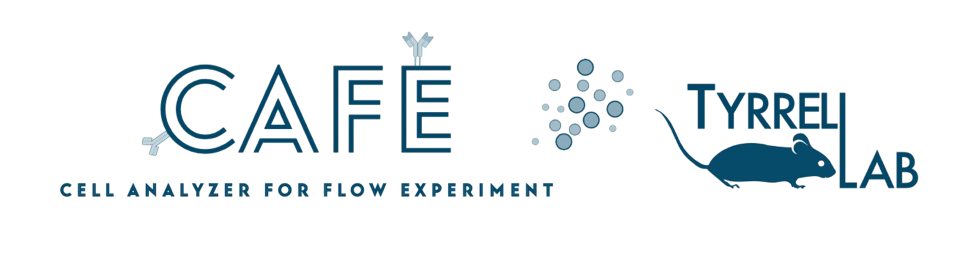

import {Aside} from '@astrojs/starlight/components';

CAFE is an open-source, free, no-code, web-app platform for high-dimensional spectral flow cytometry data (SFCM) analysis. CAFE has been developed in Python and it can run seamlessly on regular computers operating on either Windows or macOS/Linux. The application will allow the analysis and visualization of SFCM data to produce high-resolution publication-ready figures that support reproducible research of immune cell populations.
<Aside type="note" title="Update">
  CAFE is published in Bioinformatics

  Md Hasanul Banna Siam, Md Akkas Ali, Donald Vardaman, Satwik Acharyya, Mallikarjun Patil, Daniel J Tyrrell, CAFE: an integrated web app for high-dimensional analysis and visualization in spectral flow cytometry, Bioinformatics, Volume 41, Issue 6, June 2025, btaf176, <a href="https://doi.org/10.1093/bioinformatics/btaf176">https://doi.org/10.1093/bioinformatics/btaf176</a>
</Aside>
