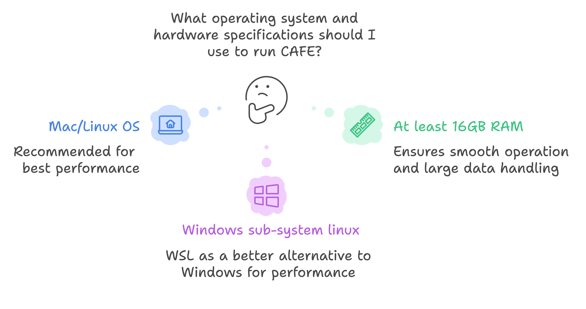

| Requirement | Recommendation | Why |
| --- | --- | --- |
| Operating system | macOS or Linux | Best performance. |
| Windows | Windows Subsystem for Linux (WSL) | Faster than running CAFE on Windows directly. |
| Memory | At least 16 GB RAM | Smooth operation and room for large datasets. |

