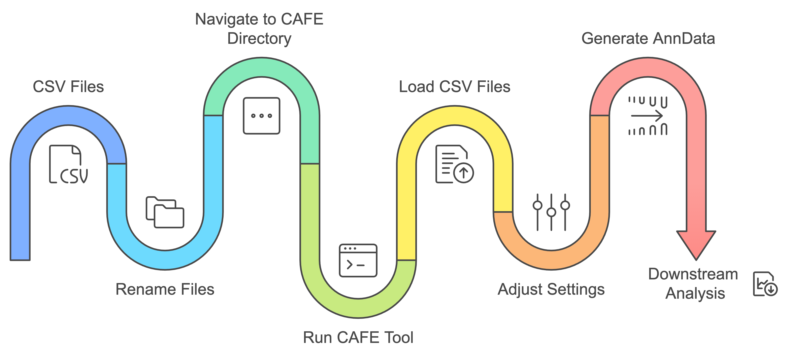

1. **CSV files**: export scaled CSV files from FlowJo or similar software.
2. **Rename files**: name each file `SampleID_Group.csv`.
3. **Navigate to the CAFE directory** in a terminal.
4. **Run CAFE**: start the app, which opens in your browser.
5. **Load CSV files** on the Data Processing page.
6. **Adjust settings** for quality control, batch correction, UMAP and Leiden clustering.
7. **Generate AnnData**: CAFE processes the files into one AnnData object.
8. **Downstream analysis**: visualize, merge, annotate and export results.

